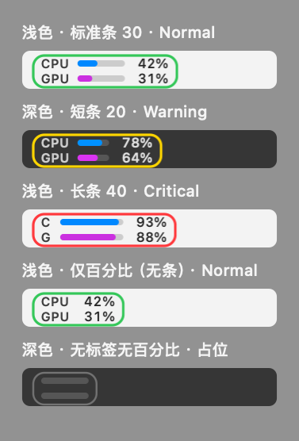

# 阶段三 · 核心采集与实时数据

> 目标：把阶段一验证过的采集实现迁进 `MonitorKit`，用一个 1 Hz 循环驱动 UI，
> 并在接入过程中把"显示的数字"重新校准一次——这一步发现了一个阶段一没暴露的问题。

---

## 1. 交付内容

| 模块 | 文件 | 说明 |
|---|---|---|
| CPU | `MonitorKit/CPUMonitor.swift` | `host_processor_info` 差值，每核 + user/system/idle + load average |
| 内存压力 | `MonitorKit/MemoryPressureMonitor.swift` | `DispatchSource` 事件 + `sysctl` 初值 + 明细 |
| GPU 硬件口径 | `MonitorKit/GPU/GPUSampler.swift` | `IOReportGPUSampler`：频率状态驻留 → 非 OFF 占比 |
| GPU 驱动口径 | 同上 | `IOAcceleratorGPUSampler`：`Device Utilization %` |
| GPU 口径选择 | 同上 | `CompositeGPUSampler`：自动/硬件/驱动，单帧失败临时兜底 |
| IOReport 桥接 | `MonitorKit/GPU/IOReportBridge.swift` | dlsym 动态绑定、订阅、频道遍历、直方图/状态解码 |
| 调度 | `MonitorKit/SystemMonitor.swift` | **唯一** 1 Hz 定时器，串行队列，可改间隔、可停 |
| 设置 | `App/MetricLabelStyle.swift` | 标签：CPU/GPU、C/G、不显示 |

UI 侧只加了两处：`AppDelegate` 把 `SystemMonitor` 的快照转给 `MonitorStore`；
`StatusItemView` 支持标签三态与 `N/A`。

---

## 2. 数据链路

```
SystemMonitor（utility 串行队列，1 Hz）
   ├─ CPUMonitor.sample()            0.008 ms
   ├─ CompositeGPUSampler.sample()   0.10 ms   ← 过滤订阅「GPU Performance States」
   └─ MemoryPressureMonitor.details() 0.002 ms
        ↓ MonitorSnapshot（值类型，Sendable）
   DispatchQueue.main → MonitorStore.apply → @Published
        ↓
   StatusItemView.snapshot（值没变就不重绘）
```

- 内存压力变化时，`DispatchSource` 回调会**额外补发一帧**，颜色不必等下一个整秒；
- 启动瞬间先发一帧"只有压力等级"的快照，CPU/GPU 保持 `nil`（显示 `—`），
  避免用 0.0001 秒的差值算出一个假数字；
- `stop()` 会取消 timer、停止 dispatch source，长跑验证过 RSS 不涨。

---

## 3. 接入时发现的问题：Active/Idle 直方图撑不住满载

阶段一用 250 ms 采样、Metal 占空比做对照时，`Active Time / Idle Time` 直方图表现很好
（0→100% 占空比对应 29%→94%）。但接到 1 Hz 的真实循环后，**GPU 持续满载时它开始返回无效值**：

```
10:47:54  GPU 99.0  驱动自报百分比  [hw: 窗口异常 total=0.10s expected=1.00s active=0.02 idle=0.08]
10:47:56  GPU 99.0  驱动自报百分比  [hw: 忙闲解码失败]
```

原因：直方图只统计**已经结束**的活跃/空闲区间。1 秒窗口里如果 GPU 一直在跑、区间不结束，
窗口内能累计到的时长就只剩几十毫秒；再下一帧可能一个完整区间都没有 → 整帧判无效。
阶段一的矩阵用的是 250 ms 窗口、100 ms 突发负载，区间总能结束，所以没暴露。

**换成频率状态驻留（`GPU Performance States`）**：`OFF / P1…P15` 的驻留是**连续累加**的计数器，
不存在"区间没结束"的问题，delta 天然等于窗口时长。利用率 = `1 − OFF 驻留占比`。

复核（与阶段一的对照实验同机同法）：

| 真实占空比 | 驱动自报 % | **状态驻留活跃 %** | 结论 |
|---:|---:|---:|---|
| 0（空闲，有桌面合成） | 30–50 | 29–45 | 两者接近 |
| 50%（100 ms 忙 / 100 ms 闲） | 80–84 | **48.6 / 49.4 / 50.4** | 驻留口径准确 |
| 100%（背靠背 dispatch） | 99–100 | **98.8 / 100 / 100** | 驻留口径不塌缩 |

所以最终口径顺序是：**硬件活跃占比（驻留）→ 驱动百分比（兜底）→ N/A**。
直方图实现保留在 `GPUUtilization.busyTime` 里作为诊断，不再作为显示口径。

---

## 4. GPU 口径设置（按你的要求做成可选项）

| 选项 | 实现 | 特点 |
|---|---|---|
| 自动（默认） | 驻留优先，单帧失败时用驱动百分比兜底，不永久降级 | 常态线性、满载不塌缩 |
| 硬件活跃占比 | 只用 IOReport 驻留，失败显示 N/A | 连续、可解释，含系统合成 |
| 驱动自报百分比 | 只用 `IOAccelerator` | 与 Activity Monitor 同源，但高负载饱和 |

Popover 里的"来源"一行会显示当前实际使用的口径（如"硬件活跃占比"）。

---

## 5. 标签三态与宽度

设置项 `labelStyle`：`CPU / GPU`、`C / G`、不显示。宽度随标签与百分比开关联动：

| 标签 | 显示百分比 | 不显示百分比 |
|---|---:|---:|
| CPU / GPU | **93 pt** | 65 pt |
| C / G | **82 pt** | 54 pt |
| 不显示 | **70 pt** | 42 pt |

自检实测（`--self-check`）：

```
标签宽度: full=93  short=82  hidden=70
隐藏百分比: length 93.0 -> 65.0
```



---

## 6. 验证结果

**CPU 准确性**（外部起 10 个 `yes`）：

```
10:49:27  99.8%    10:49:28  99.6%    10:49:29  99.9%
```

空闲时 42%（系统本身有背景负载），与 `ps`/`yes` 对照一致。

**GPU 准确性**：见第 3 节表格；50% 占空比下读数 48.6–50.4%，100% 下 98.8–100%。

**GPU 不可用**：把口径设为"硬件活跃占比"、并模拟订阅失败时，菜单栏显示 `N/A`，
Popover 保留原因文本（"当前系统未提供 GPU 硬件计数器"）。

**内存压力**：启动即读到 Normal（绿框），`DispatchSource` 已就绪；warn/critical 仍需
`sudo memory_pressure -S` 手动验证（阶段二文档 4.3 有命令）。

**内存明细口径**（与活动监视器「内存」页对齐）：

macOS 没有"一次调用返回这四个数"的公开 API，活动监视器自己也是从
`host_statistics64(HOST_VM_INFO64)` + `sysctl vm.swapusage` + `hw.memsize` 算的。我们用同样的公式：

```
page          = vm_kernel_page_size              // Apple Silicon 16384
App Memory    = (internal_page_count − purgeable_count) × page
Wired         = wire_count × page
Compressed    = compressor_page_count × page
Memory Used   = App + Wired + Compressed
Cached Files  = (external_page_count + purgeable_count) × page
Swap Used     = xsw_usage.xsu_used
Total         = hw.memsize
```

实测与本机 `vm_stat` 对齐（例如 918624 匿名页 / 23373 可清除页 → 已用 23.2 GiB、缓存 6.9 GiB）。
全部是公开 API，不需要 root，也不需要私有框架。

**资源占用**（`--soak` / `--dump`）：

| 模式 | 自身 CPU | RSS |
|---|---|---|
| 1 Hz + 菜单栏 | 0.50–0.67%（单核占比） | 79 MB |
| 1 Hz 无界面（`--dump`） | 0.26% | 59 MB |
| 5 s 间隔 + 菜单栏 | 0.11–0.15% | 78 MB |

- 采样本身只要 **0.7–1.2 ms/帧**（含 CPU + GPU + 内存 + 快照构造）；
- 剩下的开销主要是菜单栏每秒重绘（约 3 ms/次，AppKit 状态栏窗口合成）；
- 折算成整机：0.6% / 10 核 ≈ **0.06%**，符合"轻量"目标。

---

## 7. 已知限制

1. **GPU 空闲基线不是 0**：桌面合成会让 GPU 有 20%–50% 的活跃时间，这是系统口径
   （驱动自报值同一时刻也是这个量级），不是采集误差。
2. **驱动口径在高负载饱和**：60% 与 80% 真值只差 0.9 个百分点，所以它只做兜底。
3. **warn/critical 未端到端验证**：需要 root 模拟，命令已给。
4. **设置界面还没有**：三个键（百分比、标签、GPU 口径、刷新间隔）已经能持久化，
   UI 在阶段四补。
5. **RSS 79 MB**：主要是 AppKit + SwiftUI 运行时；若要更低，阶段五可把 Popover 换成纯 AppKit。

---

## 8. 下一步（阶段四）

1. 设置窗口：标签三态、两个百分比开关、GPU 口径单选、刷新间隔；
2. 开机启动（`SMAppService`，需要签名后放进 `/Applications`）；
3. 压力三色自定义（颜色选择器 → 存 NSColor 归档）；
4. Popover 补充每核明细、GPU 来源与"为什么是 N/A"。
