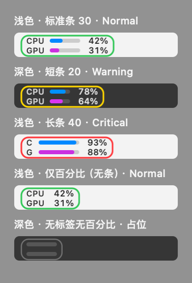
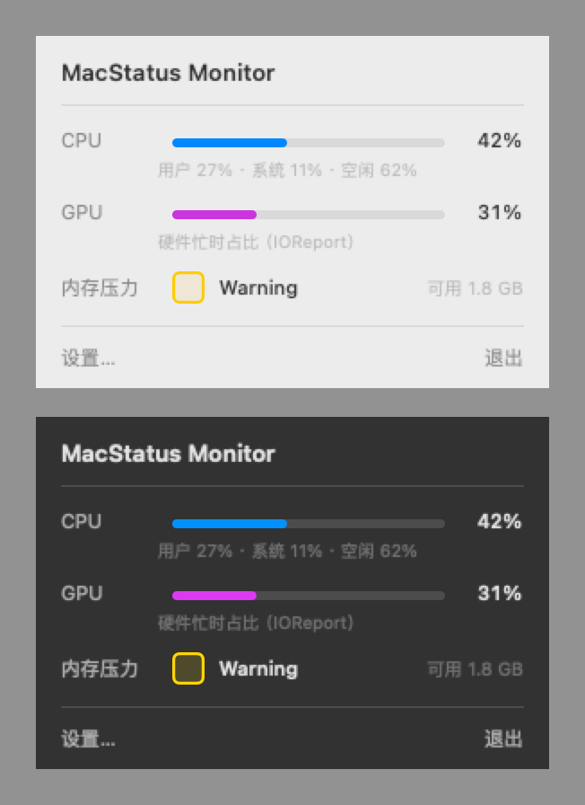

# 阶段二 · 项目骨架与菜单栏程序

> 目标：建立可编译、可运行、可签名的工程骨架，把阶段一验证过的采集代码留好位置，
> 并先把"菜单栏长什么样"用真实像素确定下来——**暂不接数据**（阶段三再接）。

---

## 1. 交付物

| 交付物 | 路径 |
|---|---|
| Swift 包工程 | `MacStatusMonitor/Package.swift` |
| 采集层（空壳 + 数据模型） | `MacStatusMonitor/Sources/MonitorKit/` |
| 应用入口 / 状态栏 / Popover | `MacStatusMonitor/Sources/MacStatusMonitor/` |
| 构建、打包、渲染脚本 | `MacStatusMonitor/Scripts/` |
| 可直接运行的 .app | `MacStatusMonitor/dist/MacStatus Monitor.app` |
| 界面预览（浅/深色） | `Docs/previews/menubar.png`、`Docs/previews/popover.png` |

---

## 2. 为什么用 SwiftPM 而不是 .xcodeproj

- 整个工程可以**用命令行完整复现**：`build.sh` → `package-app.sh`，不依赖 Xcode GUI 的签名/构建设置；
- 你仍然可以用 Xcode 打开：`open MacStatusMonitor/Package.swift`；
- 本项目没有 storyboard、没有 Asset Catalog 依赖，SwiftPM 的"可执行文件 + 手工组装 .app"足够；
- 代价：`.app` 的 Info.plist、图标、签名都在 `Scripts/package-app.sh` 里手工维护，
  而不是 Xcode 的 Build Settings。对这样一个小工具来说更透明。

> 如果你希望后续用 Xcode 的 Archive/Notarize 流程，阶段六可以再加一个 `.xcodeproj`
> 或 `xcodebuild -exportArchive` 的配置，源码不需要改。

---

## 3. 结构

```
MacStatusMonitor/
├── Package.swift                     macOS 14+，两个 target
├── Sources/
│   ├── MonitorKit/                   ← 纯数据层，不 import AppKit/SwiftUI
│   │   └── MonitorSnapshot.swift     MonitorSnapshot / MemoryPressureLevel / GPUMetric
│   └── MacStatusMonitor/
│       ├── main.swift                入口；含 --render-previews
│       ├── App/
│       │   ├── AppDelegate.swift     单实例、装配、自检/长跑入口
│       │   ├── AppSettings.swift     UserDefaults 设置（百分比开关、GPU 口径、刷新间隔）
│       │   └── MonitorStore.swift    UI 唯一数据源（@Published snapshot）
│       ├── MenuBar/
│       │   ├── MenuBarController.swift  NSStatusItem + Popover + 右键菜单
│       │   └── StatusItemView.swift     自绘：两条进度 + 压力外框
│       ├── Popover/
│       │   └── MonitorPopoverView.swift SwiftUI 详情面板
│       └── Debug/
│           ├── PreviewRenderer.swift  离屏渲染 PNG（不依赖截屏权限）
│           └── SoakReporter.swift     自身 CPU/RSS 长跑
├── Resources/Info.plist              LSUIElement、最低系统 14.0
└── Scripts/
    ├── build.sh                      swift build（沙盒环境用 --disable-sandbox）
    ├── package-app.sh                组装 .app + codesign
    └── render-previews.sh            生成 Docs/previews
```

### 分层约束（后续阶段保持）

- `MonitorKit` 不 import AppKit / SwiftUI，可单测；
- `MonitorStore` 是 UI 唯一数据源，UI 不直接调采集；
- `StatusItemView` 只负责画，不持有任何 monitor；
- 采集层将来只由 `SystemMonitor` 一个 1 Hz 循环驱动。

---

## 4. 菜单栏视图的实现要点

### 4.1 尺寸

| 项 | 值 |
|---|---|
| statusItem.length（CPU/GPU 标签 + 百分比） | **93 pt** |
| statusItem.length（C/G 标签 + 百分比） | 82 pt |
| statusItem.length（无标签 + 百分比） | 70 pt |
| statusItem.length（CPU/GPU 标签，无百分比） | 65 pt |
| button 实际尺寸 | 93 × 22 pt |
| status item 窗口 | 97 × 34 pt（含系统边距） |
| 行高 / 条高 | 8.25 pt / 4 pt |
| 压力外框 | 包住两行，圆角 7 pt，描边 1.6 pt |
| 字体 | 标签 8 pt semibold、百分比 8.5 pt 等宽数字 |

实测（`--self-check`）：

```
statusItem.length = 93.0
view.frame = (0.0, 0.0, 93.0, 22.0)
button.frame = (0.0, 0.0, 93.0, 22.0)
window = true  visible = true  frame = (903.0, 1073.0, 97.0, 34.0)
```

### 4.2 两个踩坑点

1. **不能用 `autoresizingMask` 让视图跟随按钮**。
   首次布局时 statusItem 宽度还不是最终值，autoresizing 把视图撑成了 **214 pt**，
   右侧内容被裁到屏幕外。改为 Auto Layout 四边约束后 exact：视图与按钮同为 93 × 22。

2. **`hitTest` 必须返回 nil**。
   自绘视图铺满按钮后，如果不放弃命中测试，点击会被视图吃掉，`NSStatusBarButton`
   收不到 action，菜单栏点不开 Popover。

### 4.3 视觉

- 进度条：圆角胶囊轨道（`labelColor` 16% 透明）+ 同色填充；值 >0 时最少给 3 pt 可见宽度；
- 压力外框：**包住 CPU/GPU 两行的圆角外框**，只描边（1.6 pt），不填充，无文字；
  不单独占一列，所以整体宽度比"右侧徽章"方案短 16 pt（93 vs 109）；
- 全部用系统语义色（`systemBlue` / `systemPurple` / `systemGreen` / `systemYellow` / `systemRed` /
  `labelColor`），跟随深浅色与菜单栏 vibrancy 自动适配；
- 只有快照变化才 `needsDisplay = true`，没有持续动画，不闪。

预览（浅色 Normal / 深色 Warning / 浅色 Critical 仅进度条 / 深色 占位）：



### 4.4 Popover

- `NSPopover` + `NSHostingController`，尺寸按 SwiftUI fitting size 计算（实测 **286 × 211**）；
- **懒加载**：第一次点击才创建 SwiftUI hosting，可少占约 **8 MB** RSS；
- 展示 CPU / GPU / 内存压力三行 + 退出按钮，为阶段三的"每核详情、GPU 口径说明"留好位置。



---

## 5. 验证结果

| 验证项 | 方法 | 结果 |
|---|---|---|
| 编译 | `./Scripts/build.sh` | 通过（macOS 14 部署目标，Swift 6.4 工具链） |
| 打包签名 | `./Scripts/package-app.sh` | 通过，`codesign --verify` 满足 Designated Requirement |
| 菜单栏安装 | `--self-check` 打印 item 与窗口 frame | 通过，窗口位于 (887, 1073)，尺寸 113×34 |
| 宽度联动 | 自检里切换两个百分比开关 | 93 → 65，再恢复 93 |
| Popover | 用与点击相同的代码路径 `popover.show(...)` | `isShown = true`，286×211 |
| 单实例 | 连续 `open` 两次 | 只剩 1 个进程 |
| 空闲开销 | `--soak 25` | 自身 CPU **0.01%**，RSS **72.5 MB**（稳定不涨） |
| 深浅色 | 离屏渲染两套外观 | 通过（见预览图） |

> 说明：本环境没有屏幕录制权限，`screencapture` 被 TCC 拒绝，所以界面验证用
> "离屏渲染 + 读取 status item 窗口 frame"两条路，而不是截图。你在自己桌面上直接看菜单栏即可。

### 关于 72 MB RSS

这是"AppKit + SwiftUI 运行时 + 菜单栏窗口"的常驻成本，不是泄漏（长跑 25 秒稳定在 72.5 MB）。
如果阶段五要求更低，可以把 Popover 改成纯 AppKit，预计能降到 40 MB 左右；
但那会牺牲设置界面的开发效率，建议先看阶段三接入数据后的实际数值再决定。

---

## 6. 已知限制（阶段二范围内）

1. ~~没有实时数据~~：阶段三已接入（见 `Docs/阶段三-核心采集.md`）。
2. **Popover 高度是创建时算好的**：阶段三加入每核列表后需要按内容动态改 `contentSize`。
3. **右键菜单没有自动化验证**：`NSMenu.popUp` 会阻塞等待用户选择，只能人工点一次确认。
4. **未做开机启动**：`SMAppService` 需要把签名后的 .app 放进 `/Applications`，阶段四一起做。
5. **未做设置界面**：`AppSettings` 已经能持久化三个键，但还没有 UI。

---

## 7. 下一步（阶段三）

1. 把阶段一 `Tools/Probes` 里的 `CPUSampler` / `MemoryPressureSampler` / `IOReportBridge` /
   `GPUUtilization` 迁进 `MonitorKit`（去掉探针里的实验代码，保留能力探测与降级）；
2. 实现 `GPUSampler` 协议 + 两种实现（硬件忙时占比 / 驱动百分比），按 `AppSettings.gpuMetric` 选择；
3. 实现 `SystemMonitor`：**一个** 1 Hz 循环，产出 `MonitorSnapshot`，支持改间隔与停止；
4. 接进 `MonitorStore`，让菜单栏真正跳起来；
5. 用阶段一的占空比实验脚本，对"菜单栏显示的 GPU 数字"再做一次回归（防止接线时把口径弄错）。
