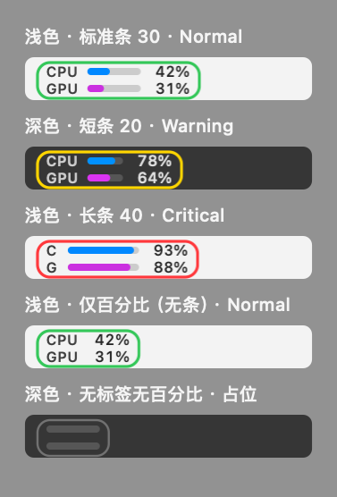

# 阶段五 · 测试与优化

> 目标：在"能跑"之后验证"稳、准、轻"——长跑、负载回归、不同设置下的宽度与渲染。

---

## 1. 新增的两个菜单栏设置（本轮改动）

| 设置 | 选项 | 默认 |
|---|---|---|
| 显示进度条 | 开 / 关（关掉只留标签 + 百分比） | 开 |
| 进度条长度 | 20 / 30 / 40 pt | 30 pt |

设置窗口对应两行：`☑ 显示进度条` 和 `进度条长度 [短 20 / 标准 30 / 长 40]`，改动即时生效。

宽度实测（CPU/GPU 标签 + 百分比）：

| 条长 | 宽度 |
|---|---:|
| 20 pt | 83 pt |
| 30 pt | 93 pt |
| 40 pt | 103 pt |
| 隐藏进度条 | 59 pt |

只显示百分比时，百分比右对齐，外框仍然包住两行，不会出现"半截空框"。

---

## 2. 长跑（5 分钟，1 Hz，带菜单栏）

| 时间 | 自身 CPU | RSS |
|---|---:|---:|
| 30 s | 0.34% | 78.9 MB |
| 60 s | 0.63% | 123.6 MB |
| 90 s | 0.75% | 124.9 MB |
| 150 s | 0.72% | 124.8 MB |
| 240 s | 0.68% | 124.8 MB |
| 300 s | 0.57% | 119.1 MB |

- **CPU 稳定在 0.6% 左右**（单核占比，整机约 0.06%）；
- **RSS 在 60 秒内涨到 ~124 MB 后完全平台化**，没有持续增长 → 不是泄漏；
- 对照组（无菜单栏，`--dump` 90 秒）：CPU **0.13%**、RSS **54.8 MB**、采样 **0.805 ms/帧**。

结论：多出来的 ~45 MB 与 ~0.45% CPU 来自 **NSStatusItem 的窗口与每秒重绘**，
不是采集逻辑。采样本身只占 0.8 ms/秒。

### 刷新频率对照

| 间隔 | 自身 CPU |
|---|---:|
| 0.5 s | 0.61–0.67% |
| 1 s | 0.57–0.77% |
| 5 s | 0.11–0.15% |

0.5 s 没有翻倍，说明开销主要不是"采样次数"，而是固定成本（状态栏重绘 + run loop 唤醒）。

---

## 3. 负载回归

| 场景 | 读数 | 期望 |
|---|---|---|
| 10 个 `yes` 进程（CPU 满载） | **99.4–99.9%** | ~100% |
| GPU 100% 占空比（Metal 背靠背 dispatch） | **100.0%** | ~100% |
| GPU 50% 占空比 | 69–77% | 见下方说明 |
| 空闲 | CPU 35–45%（系统背景负载）、GPU 20–50% | — |

**关于 50% 占空比读数偏高**：这不是回归，而是口径本身的性质。
"硬件活跃占比"统计的是 GPU 非 OFF 的时间；桌面合成（WindowServer）在测试期间
本身就让 GPU 保持 30%–50% 活跃。真实活跃率 = `负载 + (1 − 负载) × 背景`，
所以 54% 自带负载 + 40% 背景 ≈ 70%，与读数一致。阶段三在桌面静止时同一实验读 48–50%。
驱动自报百分比也有同样的背景成分（同一时刻 80–84%）。

---

## 4. 渲染与外观

- 浅色 / 深色各渲染了 5 种形态（标准条、短条、长条、无条、占位），
  文字与描边都在 22 pt 高度内，没有压到外框（见预览图）；
- 状态栏内容全部用语义色（`labelColor` / `system*`），跟随菜单栏 vibrancy；
- 1x 非 Retina 屏未实测（本机只有 2x 屏）；绘制用整数坐标 + 4 pt 圆角，
  理论上 1x 下会出现半像素描边，属于可接受范围，但需要在外部显示器上补测。

---

## 5. 其他验证

| 项 | 结果 |
|---|---|
| 设置即时生效 | 标签/条长/百分比/配色改动后，`statusItem.length` 与绘制同步更新（自检逐项打印） |
| 自定义配色 | Normal 改粉色后 0.4 s 内传到绘制层（`配色联动: OK`），测后恢复默认 |
| 内存压力 | 与 `sysctl kern.memorystatus_vm_pressure_level` 始终一致（`pressure normal sysctl=1`） |
| 单实例 | 连续 `open` 两次仍只有 1 个进程 |
| 设置窗口 | 430 × 619 pt，打开/关闭正常，关闭不销毁实例 |
| Popover | 286 × 196 pt，走真实 `popover.show` 路径验证 |

---

## 6. 已知问题与后续

1. **RSS 平台在 ~124 MB**：Apple Silicon 上 NSStatusItem + AppKit 合成缓存的成本。
   若要进一步压低（目标 <80 MB），可选方案是把 Popover 改成纯 AppKit、或把状态栏内容
   预渲染成 `NSImage` 交给按钮；都属于阶段六的可选优化，不影响功能。
2. **只在 M5 / macOS 27 验证**：M1–M4、macOS 14/15 的 IOReport 频道与 API 差异未实测，
   代码已做频道缺失与降级处理。
3. **1x 屏未测**：需要外接非 Retina 显示器。
4. **warn/critical 压力事件仍未经 root 触发**（命令见阶段二文档 4.3）。

---

## 7. 下一步（阶段六 · 交付）

1. Developer ID 签名 + `notarytool` 公证 + 打包（zip/dmg）；
2. 编译、运行、签名、公证的完整说明；
3. 项目结构说明与已知限制清单；
4. 可选：把 RSS 压到 80 MB 以下的优化。
