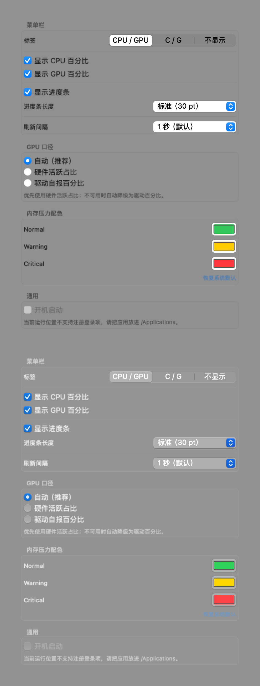

# 阶段四 · 设置界面、配色与开机启动

> 目标：把阶段三持久化的四个键做成可用的设置窗口，补上内存压力三色自定义与开机启动；
> 同时修掉你反馈的两个问题（内存压力显示黄色、Popover 的"更新于"）。

---

## 1. 修掉的两个问题

### 1.1 内存压力显示黄色，但活动监视器是绿色

**原因**：等级之前只靠 `DispatchSource` 事件维护。压力从 warning 回落到 normal 时，
系统不保证再投递一次 `.normal` 事件，于是应用一直停在旧的黄色状态——
实测 `kern.memorystatus_vm_pressure_level = 1`（Normal），但进程里缓存的等级还是 warning。

**修复**：事件只当"该刷新了"的触发，**每个 tick 都重新读 sysctl**，以它为准：

```swift
// MemoryPressureMonitor
@discardableResult
public func refreshLevel() -> MemoryPressureLevel {
    let raw = Self.readRawLevel()
    guard let mapped = MemoryPressureLevel(rawLevel: raw) else { return level }
    if mapped != level { level = mapped }
    return mapped
}
```

- 没有引入任何自定义阈值，仍然只读内核给出的等级；
- 事件的即时性和轮询的自愈能力都保留；
- 已验证：`--dump` 与 `--self-check` 都输出 `pressure = normal, sysctl = 1`，与活动监视器一致。

### 1.2 Popover 的"更新于 HH:mm:ss"

已删除。现在标题下方直接是 CPU/GPU/内存三行，Popover 高度从 211 pt 降到 **196 pt**。

---

## 2. 设置窗口



| 分组 | 设置项 | 说明 |
|---|---|---|
| 菜单栏 | 标签：CPU/GPU、C/G、不显示 | 分段控件，实时改变状态栏宽度（93 / 82 / 70 pt） |
| 菜单栏 | 显示 CPU / GPU 百分比 | 两个独立勾选 |
| 菜单栏 | 显示进度条 / 进度条长度 | 可关闭进度条只留百分比；长度 20 / 30 / 40 pt |
| 菜单栏 | 刷新间隔 | 0.5 / 1 / 2 / 5 秒 |
| GPU 口径 | 自动 / 硬件活跃占比 / 驱动自报百分比 | 选项下方跟一段口径说明 |
| 内存压力配色 | Normal / Warning / Critical | 三个 ColorPicker + "恢复系统默认" |
| 通用 | 开机启动 | `SMAppService.mainApp`，失败原因直接显示 |

- 窗口尺寸 **430 × 619 pt**，复用同一个实例，关闭不销毁；
- 打开方式：右键菜单 →「设置…」（⌘,），或 Popover 左下角「设置…」；
- 所有改动即时生效并写入 `UserDefaults`，不需要重启应用。

### 自定义配色的实现

- 默认值仍是 `systemGreen / systemYellow / systemRed`（跟随深浅色）；
- 用户改过的颜色按 sRGB 分量存 `UserDefaults`；
- 绘制层拿到的是不可变的 `PressurePalette`，状态栏外框和 Popover 色块共用同一份；
- "是否默认"用分量比较而不是对象比较——动态系统色和读回的 sRGB 色对象不相等，但视觉相同。

---

## 3. 开机启动

用 `SMAppService.mainApp`（macOS 13+），不需要 helper bundle。

| 状态 | 界面表现 |
|---|---|
| `notRegistered` | 可以打开；注册成功后 `enabled` |
| `requiresApproval` | 提示去「系统设置 → 通用 → 登录项」允许 |
| `notFound` | 开关仍然可用（实测此时 `register()` 仍可能成功）；失败时显示系统错误 |

**实测更正**：ad-hoc 签名不是阻塞项。把应用放进 `/Applications`、并确保
LaunchServices 里只有一份副本后，`SMAppService.mainApp.register()` 可以直接成功
（`status = enabled`）。之前失败是因为 `dist/` 与 `/Applications/` 两份副本同时注册，
系统解析到了错误的一份。

---

## 4. 验证记录（`--self-check`）

```
popover shown = true / true  size = (286.0, 196.0)
settings window = (430.0, 619.0)  visible=true
配色联动: OK
login item status = notFound
标签宽度: full=93  short=82  hidden=70
条宽: 20=83  30=93  40=103  hidden=59
snapshot = cpu 53.79 gpu 40.63 pressure normal sysctl=1
```

- 配色联动：把 Normal 改成粉色后，绘制层的 palette 在 0.4 秒内同步为粉色（测试后已恢复默认）；
- 设置窗口与 Popover 都能正常创建、显示；
- 压力等级与 sysctl 一致。

---

## 5. 已知限制

1. **开机启动需要分发条件**：ad-hoc 签名 + 非 `/Applications` 时无法注册，界面会明示原因而不是静默失败。
2. **没有重置全部设置的按钮**：目前只有"恢复系统默认颜色"；完整重置留到交付前再补。
3. **设置窗口不可缩放**：内容固定，430×558 在 13 寸与 16 寸屏都放得下。
4. **颜色选择器只支持单色**：不支持半透明/渐变（菜单栏也不需要）。

---

## 6. 下一步（阶段五 / 六）

1. 长跑与泄漏检查（1 Hz 跑 30 分钟，观察 RSS/CPU 曲线）；
2. 不同缩放下检查 1x/2x 渲染与菜单栏宽度；
3. 深浅色、壁纸明暗（vibrant 背景）下的对比度；
4. 打包：Developer ID 签名、notarytool 公证、dmg 或 zip；
5. 交付文档：编译/运行/已知限制。
