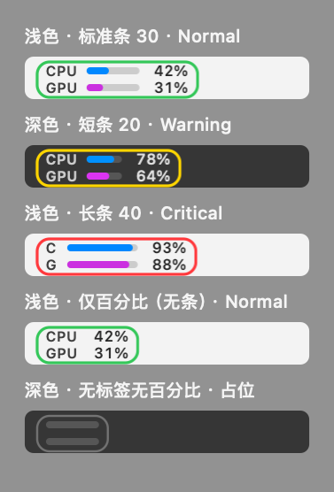
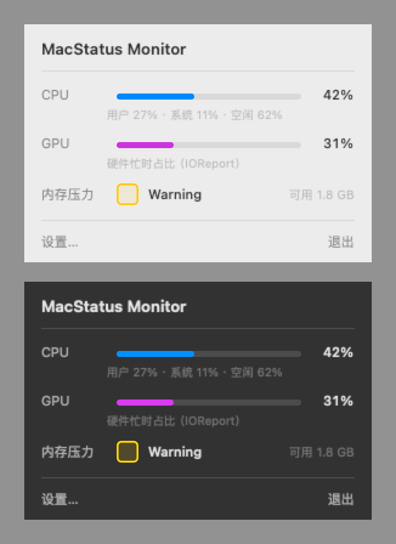
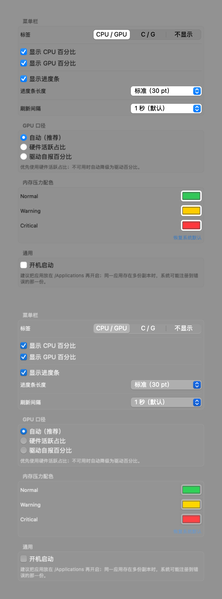

# MacStatus Monitor

轻量级 macOS 菜单栏系统监控：**CPU 使用率、GPU 使用率、内存压力**一眼看清。

原生 Swift + AppKit/SwiftUI，无第三方依赖；1 Hz 刷新下自身 CPU 约 0.6%（单核），
单次采样 0.8 ms。



## 特性

- **菜单栏两行**：CPU（蓝）/ GPU（紫）圆角进度条 + 实时百分比
- **标签三态**：`CPU/GPU`、`C/G`、不显示；百分比可分别开关
- **进度条可调**：20 / 30 / 40 pt，也可以关掉只留百分比
- **内存压力**：用彩色圆角外框包住整个图标，Normal 绿 / Warning 黄 / Critical 红，无多余文字
- **详情面板**：点击展开 CPU 分项（用户/系统/空闲）、GPU 口径与来源、内存明细
- **GPU 口径可选**：硬件活跃占比（推荐）/ 驱动自报百分比 / 自动降级
- **设置窗口**：标签、条长、百分比、刷新间隔、GPU 口径、压力三色、开机启动
- **低占用**：单一 1 Hz 定时器，值不变就不重绘

## 截图

| 菜单栏 | 详情面板 | 设置 |
|---|---|---|
|  |  |  |

## 系统要求

- macOS **14.0** 及以上
- Apple Silicon（M1–M5）原生 arm64；Intel 未测试
- Xcode 15+ / Swift 5.9+（仅编译需要）

## 安装

### 下载

到 [Releases](../../releases) 下载 `MacStatusMonitor-1.0.0.zip`，解压后把
`MacStatus Monitor.app` 拖进 `/Applications`。

> 当前发布包是 ad-hoc 签名（没有 Developer ID），从网络下载后 Gatekeeper 会拦截：
> 右键点击应用 → **打开** → 再确认一次即可。

### 从源码构建

```bash
git clone https://github.com/captain-fat/macstatus-monitor.git
cd macstatus-monitor/MacStatusMonitor

./Scripts/build.sh          # 编译（release）
./Scripts/package-app.sh    # 组装 .app + ad-hoc 签名 + zip
open "dist/MacStatus Monitor.app"
```

签名与公证（对外分发）：

```bash
CODESIGN_IDENTITY="Developer ID Application: Your Name (TEAMID)" ./Scripts/package-app.sh

xcrun notarytool store-credentials "msm-notary" \
  --apple-id "you@example.com" --team-id "TEAMID" --password "app-specific-password"

CODESIGN_IDENTITY="Developer ID Application: …" NOTARY_PROFILE="msm-notary" ./Scripts/package-app.sh
```

## 使用

- **左键**点击菜单栏图标：展开详情面板；**右键**：设置、标签、关于、退出
- 设置里的改动即时生效，不需要重启
- **开机启动**：应用放进 `/Applications` 后在设置里勾选即可；
  同一应用只保留一份副本（`dist/` 里的副本会与 `/Applications` 冲突）

## 工作原理

| 指标 | 数据来源 | 说明 |
|---|---|---|
| CPU | `host_processor_info` 相邻 tick 差值 | 每核 + user/system/idle，32 位回绕安全 |
| GPU | `IOReport` → `GPU Performance States` 驻留 | 非 OFF 时间占比，连续累加、不塌缩；失败降级到 `IOAccelerator` |
| 内存压力 | `DispatchSource` 事件 + `sysctl kern.memorystatus_vm_pressure_level` | 事件负责"及时"，每秒读 sysctl 负责"准确"；不使用已用内存比例 |

架构上采集层（`MonitorKit`）不依赖 AppKit/SwiftUI，UI 只订阅 `MonitorSnapshot`。
更多细节见 [Docs](Docs/)，包括 GPU 采集方案的对照实验与踩坑记录。

## 项目结构

```
.
├── MacStatusMonitor/          SwiftPM 工程（应用 + 采集层）
│   ├── Sources/MonitorKit/    CPUMonitor / MemoryPressureMonitor / SystemMonitor / GPU
│   ├── Sources/MacStatusMonitor/  AppKit 菜单栏 + SwiftUI Popover/设置
│   ├── Resources/             Info.plist、AppIcon.icns
│   ├── Scripts/               build / package-app / notarize
│   └── dist/                  构建产物（不提交）
├── Tools/Probes/              阶段一的采集验证探针（可复现 GPU 占空比实验）
└── Docs/                      六个阶段的技术文档与界面预览
```

## 已知限制

- GPU 真实值依赖私有 `IOReport`，**无法上架 Mac App Store**；系统升级可能改变频道，
  代码已做缺失容错与 N/A 降级
- GPU 读数包含系统合成（WindowServer），空闲桌面 5%–50% 属正常
- "驱动自报百分比"口径在高负载会饱和（60% 与 80% 真值只差 0.9 个点），仅作兜底
- 目前只在 Apple M5 / macOS 27 上完整验证；M1–M4、macOS 14/15 未实测
- 1x 非 Retina 屏、内存压力 warn/critical 事件未端到端测试
- 菜单栏常驻 RSS 约 124 MB（采集层本身约 55 MB）

## 文档

| 文档 | 内容 |
|---|---|
| [阶段一](Docs/阶段一-技术验证报告.md) | CPU/GPU/内存压力采集方案验证，GPU 占空比矩阵实验 |
| [阶段二](Docs/阶段二-项目骨架.md) | 工程结构与菜单栏自绘 |
| [阶段三](Docs/阶段三-核心采集.md) | 实时数据接入，直方图口径失效与状态驻留替换 |
| [阶段四](Docs/阶段四-设置与配色.md) | 设置窗口、配色、开机启动 |
| [阶段五](Docs/阶段五-测试与优化.md) | 长跑、负载回归、性能数据 |
| [阶段六](Docs/阶段六-交付说明.md) | 构建、签名、公证、验收清单 |

## License

[MIT](LICENSE)
